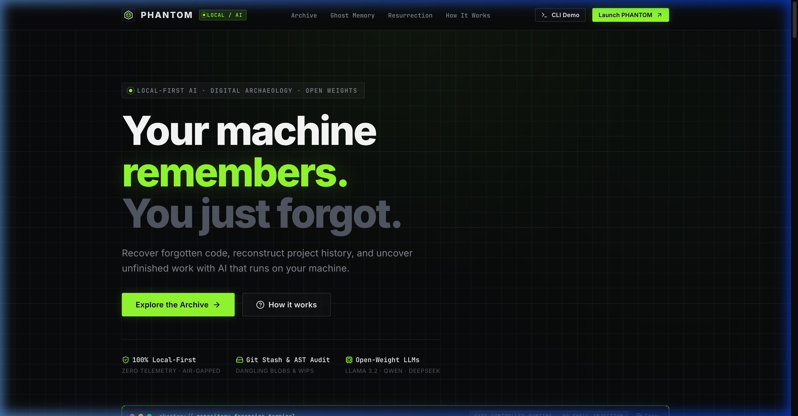
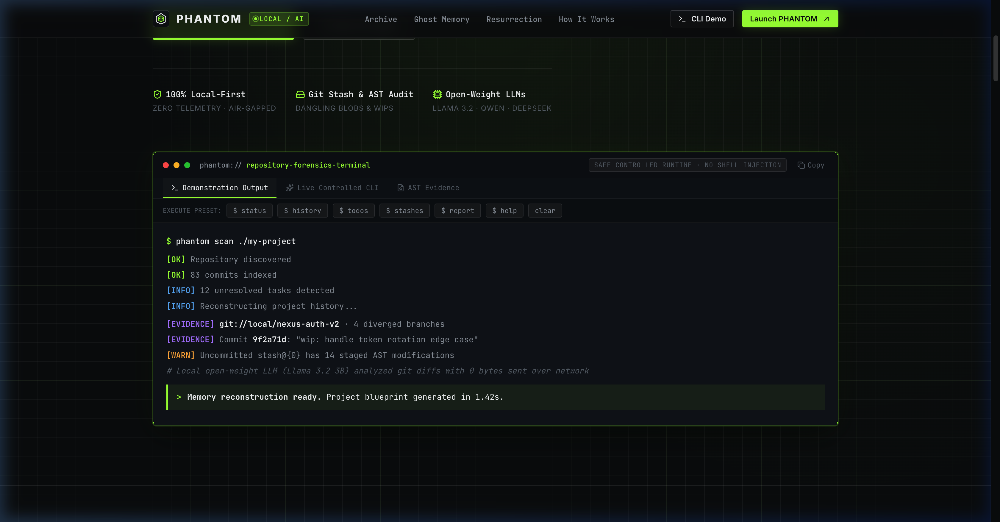
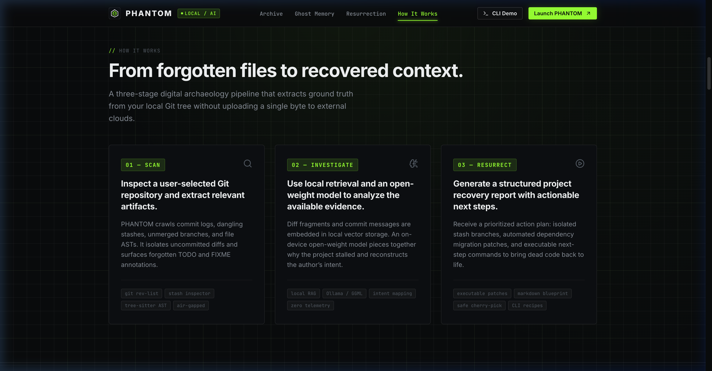
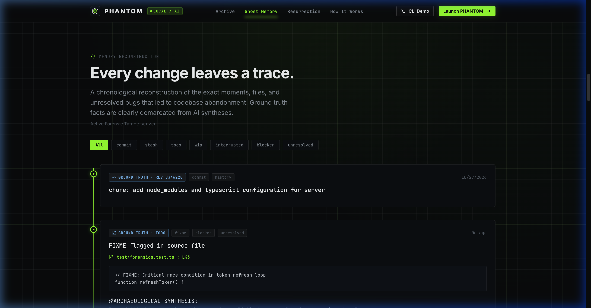

<p align="center">
  <a href="https://github.com/dr5t/PHANTOM">
    
  </a>
</p>

<h1 align="center">PHANTOM</h1>

<p align="center">
  <strong>Your Machine Remembers What You Have Forgotten.</strong><br>
  <em>A local-first AI software archaeology tool for investigating Git repositories, uncovering forgotten implementation details, and synthesizing actionable recovery plans.</em>
</p>

<p align="center">
  <a href="https://github.com/dr5t/PHANTOM"></a>
  
  
  
  
</p>

<p align="center">
  <a href="#overview">Overview</a> •
  <a href="#the-problem-software-archaeology">The Problem</a> •
  <a href="#features--implementation-status">Features & Status</a> •
  <a href="#application-walkthrough--screenshots">Screenshots</a> •
  <a href="#architecture">Architecture</a> •
  <a href="#technology-stack">Tech Stack</a> •
  <a href="#getting-started">Getting Started</a> •
  <a href="#testing-and-builds">Testing & Builds</a> •
  <a href="#local-ai-setup-optional">Ollama Setup</a> •
  <a href="#security-and-privacy-notes">Security & Privacy</a> •
  <a href="#repository-structure">Repository</a> •
  <a href="#creator">Creator</a> •
  <a href="#license">License</a>
</p>

---

<a id="overview"></a>
##  Overview

**PHANTOM** is a developer tool built to inspect existing and dormant Git codebases, extract chronological project history, surface unresolved comments and uncommitted stashes, and generate structured recovery reports. 

When connected to a local [Ollama](https://ollama.com) runtime, PHANTOM performs evidence-grounded analysis of repository artifacts (commit diffs, file trees, and source comments) using on-device open-weight models, without sending source code to hosted cloud AI APIs. If Ollama is offline or uninstalled, PHANTOM's core Git forensics, source scanning, and recovery report generation continue to operate locally via deterministic rule engines.

---

<a id="the-problem-software-archaeology"></a>
##  The Problem: Software Archaeology

Every developer has inherited unfamiliar code or revisited a project abandoned months ago:

1. **Context Dissolves**: Crucial architectural decisions disappear into sprawling Git logs or unmerged branches.
2. **Uncommitted Work Gets Shelved**: Temporary experiments and partial implementations often remain hidden in unmerged `git stash` entries.
3. **Buried Landmines**: Critical warnings, incomplete token refreshes, and temporary workarounds lie scattered across files as `TODO`, `FIXME`, or `HACK` comments.
4. **Missing Documentation**: Traditional project documentation is frequently out of sync with what the code actually does.

PHANTOM addresses this by treating the repository itself as the primary archaeological record: extracting verifiable ground truth directly from Git metadata, diffs, and source text.

---

<a id="features--implementation-status"></a>
##  Features & Implementation Status

To provide transparent documentation, the table below distinguishes between features verified end-to-end against live repositories and demonstration fixtures provided for UI exploration:

| Capability | Status | Implementation Detail |
| :--- | :---: | :--- |
| **Git Commit Forensics** | ✅ Functional | Extracts commit history, authors, timestamps, file stats, and additions/deletions using `git log` with custom format flags. |
| **Branch & Tag Inspection** | ✅ Functional | Queries local and remote branches and tag references via `git branch -a` and `git tag -l`. |
| **Git Stash Forensics** | ✅ Functional | Inspects unmerged stash entries (`git stash list`) and retrieves diff previews (`git stash show -p`). |
| **Working Tree Inspection** | ✅ Functional | Detects modified, added, and untracked files via `git status --porcelain=v1`. |
| **Commit Diff Inspection** | ✅ Functional | Validates hash patterns and retrieves diff statistics using `git show --stat -p <hash>`. |
| **Source Code & TODO Scanner** | ✅ Functional | Recursively scans files up to 500 KB (up to 2,500 files) for `TODO`, `FIXME`, `HACK`, `BUG`, `XXX`, and `NOTE` annotations with line numbers and 3-line surrounding context. |
| **Language Profiling** | ✅ Functional | Calculates language distribution across 25+ file extensions and determines the primary language. |
| **Real-time SSE Scanning** | ✅ Functional | Server-Sent Events endpoint (`/api/repos/scan-stream`) streams live progress through 6 stages (`validating` → `complete`). |
| **Controlled Terminal CLI** | ✅ Functional | Parameterized command dispatcher executing safe commands (`status`, `history`, `todos`, `stashes`, `branches`, `diff`, `models`, `ask`, `report`, `help`, `clear`). Arbitrary shell execution is blocked. |
| **Resurrection Report Generator**| ✅ Functional | Synthesizes an overview, dormancy diagnosis, historical milestones, unfinished features, risk flags, and non-destructive next steps into exportable Markdown. |
| **Ollama Local AI Discovery** | ✅ Functional | Checks `http://127.0.0.1:11434/api/tags` to discover locally installed models (e.g., Llama 3.2, Qwen 2.5 Coder). |
| **Evidence-Grounded AI Q&A** | ✅ Functional | Tokenizes queries, retrieves matching repository evidence, bounds the prompt with injection defenses, and queries the local model (or returns a deterministic forensic finding if offline). |
| **Demonstration Fixtures** | ℹ️ Labeled Fixture | Pre-configured demonstration projects (`nexus-auth-v2`, `spectral-fs`, etc.) in `src/data/mockData.ts` provide immediate interactive examples in the UI prior to scanning a repository. |

---

<a id="application-walkthrough--screenshots"></a>
##  Application Walkthrough & Screenshots

These screenshots represent the actual running application connected to its local forensics server:

### 1. Main Dashboard & Hero
*Dark grid interface displaying real-time system status and immediate entry points.*
<p align="center">
  
</p>

### 2. Controlled Forensic Terminal
*Executing `$ status` and forensic queries against a repository without exposing an unrestricted shell.*
<p align="center">
  
</p>

### 3. Real-Time Archaeological Scanner & Q&A Dialog
*Live Server-Sent Events stream showing progress through Git history, stash analysis, and TODO discovery, followed by evidence-grounded inquiry.*
<p align="center">
  
</p>

### 4. Resurrection Mode & Blueprint Export
*Structured recovery blueprint detailing dormancy causes, blockers, and safe, human-reviewed next steps with Markdown export.*
<p align="center">
  
</p>

---

<a id="architecture"></a>
##  Architecture



```mermaid
flowchart TD
    subgraph Frontend ["Frontend Client (React 19 + TypeScript)"]
        UI[Dark Grid UI]
        TERM[Controlled Terminal Component]
        MODAL[Scan & Q&A Modal]
        REP_UI[Resurrection Report View]
        API_CLIENT[src/services/api.ts]
        
        UI --> API_CLIENT
        TERM --> API_CLIENT
        MODAL --> API_CLIENT
        REP_UI --> API_CLIENT
    end

    subgraph Backend ["Forensics Backend (Node.js + Express)"]
        ROUTER[API Router /api]
        SEC[Path & Subprocess Security]
        GIT[Git Forensics Module]
        TODO[Source Code Scanner]
        EVID[Evidence Retrieval Engine]
        TERM_CMD[Controlled Command Parser]
        REPORT[Report Generator]
        OLLAMA_CLI[Ollama Client]
        STORE[(In-Memory Repo Store)]

        ROUTER --> SEC
        SEC --> GIT
        SEC --> TODO
        ROUTER --> TERM_CMD
        ROUTER --> EVID
        ROUTER --> REPORT
        EVID --> OLLAMA_CLI
        ROUTER --> STORE
    end

    subgraph LocalHost ["Host System Runtime"]
        REPO[(Target Git Repository)]
        OLLAMA_DAEMON[(Local Ollama Service 127.0.0.1:11434)]
    end

    API_CLIENT -->|HTTP / Vite Proxy| ROUTER
    GIT -->|execFile git args| REPO
    TODO -->|fs.readFile| REPO
    OLLAMA_CLI -->|HTTP /api/generate| OLLAMA_DAEMON
```

### Data Flow Walkthrough
1. **Request & Validation**: The frontend communicates with the Express backend via `/api`. The backend's security module verifies that the target path exists, is a directory, and contains a valid `.git` repository worktree.
2. **Forensic Extraction**: Subprocesses run `git log`, `git branch`, `git stash`, and `git status` using parameterized argument arrays (`execFile`) rather than string concatenation.
3. **Source Inspection**: The scanner iterates through codebase files (excluding `node_modules`, build outputs, and sensitive files), capturing `TODO`/`FIXME` lines, line numbers, and surrounding context.
4. **Evidence-Grounded Querying**: User questions are matched against commits, stashed diffs, and TODO items. If an Ollama model is available, the bounded evidence is passed to the local LLM with prompt injection safeguards. If Ollama is unavailable, a deterministic summary of discovered evidence is returned.
5. **Report Formulation**: The report generator aggregates metrics (inactivity days, author, branches, stashes, and flags) into an actionable recovery blueprint.

---

<a id="technology-stack"></a>
##  Technology Stack

### Frontend Client
- **Framework**: [React 19](https://react.dev/) (`react@^19.3.1`, `react-dom@^19.3.1`)
- **Language**: [TypeScript](https://www.typescriptlang.org/) (Strict Mode)
- **Build Tool & Dev Server**: [Vite 8](https://vitejs.dev/) with `/api` proxy configuration
- **Icons**: [Lucide React](https://lucide.dev/) (`lucide-react@^1.62.0`)
- **Styling**: Vanilla CSS with custom Dark Grid design tokens and CSS variables

### Forensics Backend
- **Runtime**: [Node.js](https://nodejs.org/) (v20+ recommended)
- **Framework**: [Express 4](https://expressjs.com/) (`express@^4.21.0`)
- **CORS Support**: `cors@^2.8.5`
- **TypeScript Runner**: [tsx](https://github.com/privatenumber/tsx) for development watch mode
- **Compiler**: TypeScript (`typescript@~5.6.0`)
- **Subprocess Execution**: Node's `child_process.execFile` with argument arrays

### Testing
- **Test Runner**: [Vitest 2.1](https://vitest.dev/) (`vitest@^2.1.0`)
- **Linter**: [Oxlint](https://oxc.rs/) (`oxlint@^1.89.0`)

---

<a id="getting-started"></a>
##  Getting Started

### Prerequisites
- **Node.js**: `v20.0.0` or higher
- **npm**: `v10.0.0` or higher
- **Git**: Installed and accessible in your shell `PATH`
- *(Optional)* **Ollama**: For local neural inference ([ollama.com](https://ollama.com))

### 1. Clone the Repository
```bash
git clone https://github.com/dr5t/PHANTOM.git
cd PHANTOM
```

### 2. Install Dependencies
Install dependencies for both the frontend client and the forensics server:
```bash
# Install root/frontend dependencies
npm install

# Install backend server dependencies
npm install --prefix server
```

### 3. Run the Development Servers
Running PHANTOM locally requires starting both the backend server and the frontend client. Use two separate terminal windows:

#### Terminal 1 — Forensics Backend:
```bash
npm run server:dev
```
*The backend server starts on `http://127.0.0.1:3001` with API routes mounted under `/api`.*

#### Terminal 2 — Frontend Client:
```bash
npm run dev
```
*The Vite frontend starts on `http://127.0.0.1:5173`. API calls to `/api/*` are automatically forwarded to `:3001` via Vite's proxy.*

Open your browser to **`http://127.0.0.1:5173`**.

---

<a id="testing-and-builds"></a>
##  Testing and Builds

All Git forensic routines, security path checks, and report generators are covered by automated tests executing against dynamically created temporary Git repositories.

```bash
# Run the backend test suite
npm test

# Run the frontend production build
npm run build

# Run the backend TypeScript compilation
npm run server:build

# Run the linter
npm run lint
```

### Verified Test Suite Output
```text
 ✓ server/test/forensics.test.ts (21)
   ✓ PHANTOM Forensics & Architecture Suite (21)
     ✓ 1. Repository Validation & Security Boundaries (5)
       ✓ validates a genuine git repository correctly
       ✓ rejects non-existent directory paths
       ✓ rejects paths containing null bytes
       ✓ rejects empty paths
       ✓ correctly detects sensitive credentials and key files
     ✓ 2. Git History & Artifact Extraction (6)
       ✓ extracts commit history with metadata
       ✓ extracts branches correctly
       ✓ extracts stashes accurately
       ✓ detects uncommitted files in working tree
       ✓ fetches commit diff content without crashing
       ✓ rejects malformed or injected diff hashes
     ✓ 3. TODO & Codebase Forensics (3)
       ✓ discovers TODO, FIXME, BUG, and HACK items with line numbers and priorities
       ✓ detects primary programming language correctly
       ✓ reads README content for context
     ✓ 4. Resurrection Report Generation (2)
       ✓ generates a structured ResurrectionReport
       ✓ formats report into valid GitHub markdown with sections and code blocks
     ✓ 5. Evidence-Grounded Q&A Engine (2)
       ✓ retrieves relevant evidence references for a query
       ✓ acknowledges lack of evidence when query is completely unrelated
     ✓ 6. Controlled Terminal Command Parser (3)
       ✓ executes safe commands like status, history, todos, stashes, help
       ✓ blocks arbitrary shell commands and outputs warning
       ✓ handles clear command

 Test Files  1 passed (1)
      Tests  21 passed (21)
```

---

<a id="local-ai-setup-optional"></a>
##  Local AI Setup (Optional)

PHANTOM's core Git analysis, source scanning, and report generation work offline without Ollama. If you wish to enable neural Q&A:

1. **Install Ollama**: Follow instructions at [ollama.com](https://ollama.com).
2. **Start the Ollama daemon**:
   ```bash
   ollama serve
   ```
3. **Pull a model**:
   ```bash
   # Lightweight option (approx. 2.0 GB)
   ollama pull llama3.2

   # Code-focused option (approx. 4.7 GB)
   ollama pull qwen2.5-coder:7b
   ```
4. **Endpoint Configuration**: By default, PHANTOM connects to `http://127.0.0.1:11434`. You can override this by starting the server with:
   ```bash
   OLLAMA_HOST=http://127.0.0.1:11434 npm run server:dev
   ```
When active, PHANTOM's UI reflects `RUNTIME STATUS: ACTIVE` and displays your installed models.

---

<a id="security-and-privacy-notes"></a>
##  Security and Privacy Notes

- **Subprocess Safety**: Subprocesses are executed strictly via `child_process.execFile` with argument arrays. User input is never evaluated in a shell, eliminating command injection risks.
- **Sensitive File Exclusion**: The scanner skips sensitive files by default, including `.env*`, `id_rsa`, `id_ed25519`, `*.pem`, `*.key`, `credentials.json`, `*secret*`, and `.git-credentials`.
- **Local Git & Model Execution**: Git commands, repository indexing, and Ollama inference execute on your local machine. Source code is not sent to external AI providers.
- **Web Font Network Requests**: In `index.html`, typography (`Inter` and `JetBrains Mono`) is imported from Google Fonts via CDN (`fonts.googleapis.com` / `fonts.gstatic.com`). Users requiring complete isolation from external network requests must self-host these font files locally.
- **Local Network Scope**: The Express backend is configured for local development (`cors` allows `origin: '*'`). It does not implement multi-user authentication or role-based access control and is intended for single-user local development environments.
- **Non-Destructive Guidance**: PHANTOM generates command recommendations for human review. It does not automatically run write or delete commands on the user's repository.

---

<a id="repository-structure"></a>
##  Repository Structure

```
PHANTOM/
├── docs/                         # Documentation Assets
│   └── assets/
│       ├── architecture.svg      # System architecture vector diagram
│       └── screenshots/          # Application screenshots
│           ├── dashboard.png
│           ├── repository-analysis.png
│           ├── ai-investigation.png
│           └── recovery-report.png
├── public/                       # Static Public Assets
│   ├── favicon.svg               # PHANTOM project emblem
│   └── icons.svg                 # SVG sprite sheet
├── server/                       # Forensics Backend (Node.js + Express)
│   ├── src/
│   │   ├── index.ts              # Express app entry & configuration
│   │   ├── routes.ts             # API routes & SSE stream endpoint
│   │   ├── git.ts                # Git operations (log, branch, stash, diff)
│   │   ├── security.ts           # Path validation & subprocess execution
│   │   ├── todos.ts              # Codebase scanner & TODO priority extraction
│   │   ├── ollama.ts             # Ollama API client & model discovery
│   │   ├── evidenceAi.ts         # Evidence grounding & prompt boundaries
│   │   ├── reports.ts            # Resurrection report formulation
│   │   ├── terminal.ts           # Controlled CLI command parser
│   │   ├── store.ts              # In-memory repository cache
│   │   └── types.ts              # Shared TypeScript definitions
│   ├── test/
│   │   └── forensics.test.ts     # Automated test suite using temp Git repos
│   ├── package.json              # Server dependencies & scripts
│   └── tsconfig.json             # Server TypeScript configuration
├── src/                          # Frontend Application (React 19 + TypeScript)
│   ├── components/               # UI components
│   │   ├── Hero.tsx              # Landing hero section
│   │   ├── Navbar.tsx            # Navigation header
│   │   ├── TerminalPreview.tsx   # Interactive controlled CLI terminal
│   │   ├── GhostMemory.tsx       # Timeline reconstruction
│   │   ├── DigitalGraveyard.tsx  # Discovered repository archive table
│   │   ├── ResurrectionMode.tsx  # Recovery report viewer & export
│   │   ├── OpenSourceAI.tsx      # Model status & configuration
│   │   └── LaunchModal.tsx       # Live SSE scan & Q&A modal
│   ├── services/
│   │   └── api.ts                # Frontend API client
│   ├── data/
│   │   └── mockData.ts           # Labeled demonstration fixtures
│   ├── types/
│   │   └── index.ts              # Frontend TypeScript definitions
│   ├── App.tsx                   # Main layout container
│   └── index.css                 # Dark grid theme tokens & styling
├── index.html                    # HTML entry point (loads web fonts)
├── vite.config.ts                # Vite config with backend proxy
├── package.json                  # Root scripts & dependencies
└── README.md                     # Project documentation
```

---

<a id="creator"></a>
##  Creator

Created and developed by **Shaurya Tiwari** ([@dr5t](https://github.com/dr5t)).

Repository: [https://github.com/dr5t/PHANTOM](https://github.com/dr5t/PHANTOM)  
Issues & Inquiries: [https://github.com/dr5t/PHANTOM/issues](https://github.com/dr5t/PHANTOM/issues)

---

<a id="license"></a>
##  License

*Notice: No license file is currently present in this repository.*

All rights are reserved by the creator. Public availability on GitHub does not automatically grant permission to reuse, modify, or redistribute this codebase for commercial or non-commercial purposes without explicit authorization.
